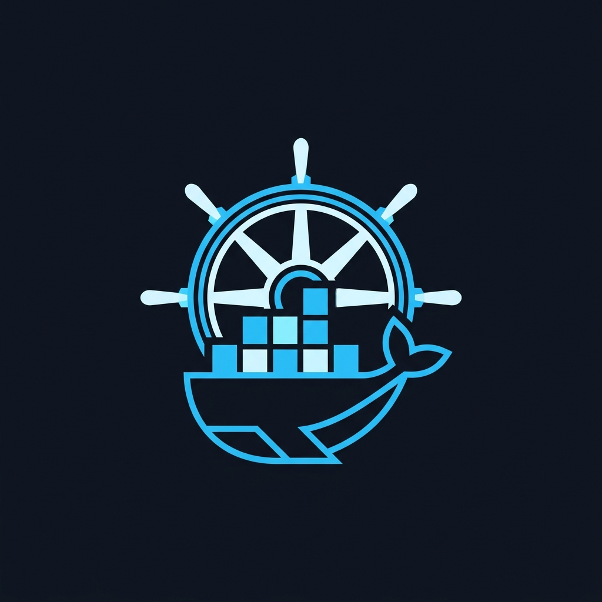

<p align="center">
  
</p>

<h1 align="center">سکان (Sokkan) — پلتفرم سبک PaaS و CI/CD خودمیزبان برای VPS</h1>

**سکان (Sokkan)** یک **PaaS (Platform as a Service)** سبک، سریع و فارسی (RTL) برای استقرار خودکار پروژه‌های GitHub، نصب یک‌کلیکه دیتابیس‌ها و سرویس‌های آماده، مدیریت کانتینرهای Docker (بدون نیاز به Portainer) و کنترل زنده `Caddyfile` با SSL خودکار روی سرورهای مجازی کم‌مصرف — **به‌ویژه بهینه‌شده برای VPSهای ۲ گیگابایت رم و شبکه ایران.**

> برای مطالعه عمیق معماری، تصمیمات امنیتی، تجربه حل مشکلات سرور ایران و راهنمای توسعه، فایل [`DOCS.md`](./DOCS.md) را ببینید.

---

## چرا سکان؟ (مقایسه کوتاه)

| ویژگی | سکان (Sokkan) | Coolify / Dokploy | مدیریت دستی SSH + Portainer |
| :--- | :--- | :--- | :--- |
| **مصرف رم پنل** | سبک (~۶۰ تا ۱۲۰MB، سقف `300m`) | سنگین (نیازمند ۲ تا ۴GB+ رم) | متوسط + بدون CI/CD |
| **کنترل مستقیم `Caddyfile`** | کامل + ویرایشگر زنده + Rollback | محدود به تنظیمات داخلی پنل | فقط دستی از ترمینال |
| **سازگاری با اینترنت ایران** | بومی (میرور آروان/Docker.ir، بدون Alpine APK) | اغلب در نصب/بیلد گیر می‌کند | نیازمند تنظیم دستی |
| **نصب یک‌کلیکه سرویس و دیتابیس** | دارد (PostgreSQL، Redis، n8n، MinIO و...) | دارد | دستی |
| **ابزار خط فرمان (`sokkan` CLI)** | دارد (`sokkan update`, `status`, `logs`, `prune`, `doctor`) | محدود | ندارد |
| **دیتابیس پنل** | SQLite تک‌فایلی (بدون Postgres/Redis اضافه) | PostgreSQL + Redis جداگانه | — |

---

## قابلیت‌ها و امکانات فعلی

### ۱. دیپلوی خودکار از گیتهاب (GitHub CI/CD)
- **تحلیل خودکار مخزن:** تشخیص خودکار `Dockerfile` یا `docker-compose.yml`، پورت `EXPOSE` و کلیدهای `.env.example` با یک کلیک.
- **پر شدن هوشمند نام و اسلاگ:** استخراج خودکار نام پروژه و شناسه کانتینر از انتهای لینک ریپو.
- **دیپلوی خودکار با Webhook و Polling:** پشتیبانی از GitHub Webhook آنی (با اعتبارسنجی امضای `HMAC-SHA256`) و بررسی دوره‌ای (Polling) برای مخازن Public و Private.
- **استریم زنده لاگ بیلد (SSE):** مشاهده لحظه‌ای خروجی `git` و `docker build` بدون رفرش صفحه.
- **مدیریت کامل `.env`:** ورود یکجا (Bulk Paste)، ویرایش، حذف متغیرها و ذخیره رمزنگاری‌شده با `AES-256-GCM`.
- **ایزوله‌سازی کامل پورت‌ها:** اجرای کانتینرها روی شبکه داخلی `web` بدون اشغال پورت‌های Host (چندین پروژه می‌توانند هم‌زمان روی پورت `80` یا `3000` بدون تداخل اجرا شوند) + محافظت در برابر ثبت دامنه تکراری.

### ۲. نصب یک‌کلیکه سرویس‌های آماده و دیتابیس‌ها (One-Click Apps)
راه‌اندازی سریع سرویس‌های پرکاربرد با **Volume دائمی**، **تولید خودکار رمزهای قوی**، **محدودیت رم (`mem_limit`)**، **رشته اتصال آماده کپی (`DATABASE_URL` / `REDIS_URL`)** و **اتصال خودکار به Caddy و SSL**:
- **دیتابیس و کش (ایزوله روی شبکه داخلی `web`):** `PostgreSQL 16` · `Redis 7` · `MariaDB 11` · `MongoDB 7`
- **اپلیکیشن‌های آماده (با دامنه و SSL خودکار):** `n8n` · `Uptime Kuma` · `MinIO (S3)` · `Memos`
- **ابزارهای مدیریت:** `Vaultwarden` · `Adminer`

### ۳. مدیریت مستقیم Docker و تمیزکاری دیسک (جایگزین Portainer)
- لیست کامل کانتینرهای سرور با وضعیت، شبکه و آمار مصرف لحظه‌ای CPU و RAM.
- مشاهده لاگ کانتینرها و کنترل مستقیم Start / Stop / Restart / Remove.
- **مانیتور فضای دیسک داکر (`docker system df`) و پاک‌سازی ایمن:** حذف ایمیج‌های قدیمی و کش بیلد بلااستفاده با یک کلیک (بدون دست زدن به کانتینرهای فعال و Volumeها).

### ۴. مدیریت زنده Caddy Reverse Proxy و SSL
- ویرایشگر کامل `Caddyfile` سراسری سرور + تزریق خودکار مسیر پروژه‌ها و سرویس‌های آماده بین نشانگرهای `# BEGIN MANAGED ROUTES` و `# END MANAGED ROUTES`.
- اعتبارسنجی واقعی و Reload زنده بدون قطعی از طریق `docker exec caddy` با بازگشت خودکار در صورت خطا.
- ثبت تاریخچه تغییرات (Snapshot) و **Rollback تک‌کلیکه** به نسخه‌های قبلی.

### ۵. امنیت دولایه و نشست پایدار
- **لایه اول (لبه سرور):** Caddy `basic_auth` با هش `bcrypt` (و مستثنی کردن هوشمند `/api/webhooks/*` برای دریافت Webhook گیتهاب).
- **لایه دوم (اپلیکیشن):** رمز عبور مدیر (`scrypt`) با کوکی امن **`HttpOnly; SameSite=Lax`** با اعتبار ۳۰ روزه (قابل تنظیم با `SESSION_TTL_DAYS`).
- رمزنگاری اسرار حساس (توکن‌های گیتهاب، کلید Webhook و متغیرهای `.env`) با `AES-256-GCM`.

### ۶. مانیتورینگ، خط فرمان (`sokkan`) و بکاپ
- نمایش لحظه‌ای و تاریخچه مصرف CPU، RAM و دیسک سرور + اتصال اختیاری به **Beszel** (`status.<domain>`).
- دستور سراسری **`sokkan`** در ترمینال سرور برای مدیریت، آپدیت، لاگ، بکاپ و عیب‌یابی سریع.
- خروجی و بازیابی پشتیبان JSON از پروژه‌ها و تنظیمات `Caddyfile`.

---

## معماری کوتاه

```text
Internet / ArvanCloud DNS
          │
          ▼
   Caddy v2 (:80 / :443, Auto SSL, Layer 1 Auth)
          │   (Docker bridge network: "web")
          ├──► sokkan-panel (:3000)     ← پنل وب + SQLite + Docker Socket
          ├──► sokkan-<project>         ← پروژه‌های دیپلوی‌شده از GitHub
          ├──► sokkan-<service>         ← دیتابیس‌ها و اپ‌های یک‌کلیکه
          └──► beszel (:8090)           ← مانیتورینگ اختیاری (status.<domain>)
```

---

## نصب سریع صفر تا صد روی VPS جدید (Ubuntu / Debian)

۱. مخزن را روی سرور کلون کنید:

```bash
sudo apt-get update && sudo apt-get install -y git
sudo git clone https://github.com/ebad84/sokkan-yar.git /opt/sokkan
cd /opt/sokkan
```

۲. اسکریپت نصب کامل (کاملاً انگلیسی) را اجرا کنید:

```bash
chmod +x bootstrap-vps.sh
sudo bash bootstrap-vps.sh
```

این اسکریپت به‌طور خودکار موارد زیر را آماده می‌کند:
- نصب `docker.io` و `docker-compose-v2` از مخازن اوبونتو و تنظیم رجیستری میرورهای ایرانی (`docker.arvancloud.ir` و `registry.docker.ir`)
- فعال‌سازی ۲ گیگابایت `Swap` در صورت نبود و تنظیم فایروال `UFW` (`22`, `80`, `443`)
- ساخت شبکه مشترک `web` و تولید کلیدهای امنیتی یکتا در `/opt/sokkan/.env`
- پیکربندی `Caddyfile` با Basic Auth دولایه روی پنل و راه‌اندازی `Caddy`، `sokkan-panel` و در صورت تمایل `Beszel`
- نصب دستور سراسری **`sokkan`** در `/usr/local/bin/sokkan`

۳. مرورگر را روی دامنه پنل باز کنید:
- **لایه اول:** نام کاربری و رمز Caddy Basic Auth را وارد کنید.
- **لایه دوم:** رمز عبور مدیر سکان را ثبت کرده و وارد داشبورد شوید.

---

## ابزار خط فرمان `sokkan` CLI

پس از نصب، دستور `sokkan` در سراسر سرور در دسترس است:

```bash
sokkan status                  # نمایش وضعیت سرویس‌ها و مصرف رم/CPU کانتینرها
sokkan update                  # دریافت آخرین نسخه از گیت و بیلد مجدد sokkan-panel
sokkan logs [service] [lines]  # مشاهده لاگ زنده (پیش‌فرض: sokkan-panel)
sokkan restart [service]       # ری‌استارت کردن کل استک یا یک سرویس مشخص
sokkan reload-caddy            # اعتبارسنجی و Reload زنده Caddyfile
sokkan prune                   # پاک‌سازی ایمن ایمیج‌ها و کش بیلد بلااستفاده
sokkan hash-password           # ساخت هش bcrypt برای Basic Auth در Caddyfile
sokkan enable-agent            # اتصال و فعال‌سازی Beszel Agent
sokkan backup [dest-dir]       # تهیه بکاپ فشرده tar.gz از data/، caddy/ و .env
sokkan doctor                  # بررسی سلامت داکر، شبکه web، رم، Swap و Caddyfile
sokkan help                    # نمایش لیست کامل دستورات
```

### به‌روزرسانی سریع روی سرور

```bash
sokkan update
```

یا به‌صورت دستی:

```bash
cd /opt/sokkan
git pull && sudo docker compose up -d --build sokkan-panel
```

---

## متغیرهای محیطی مهم (`.env`)

| متغیر | توضیح | پیش‌فرض |
| :--- | :--- | :--- |
| `PORT` | پورت داخلی پنل سکان | `3000` |
| `DOCKER_NETWORK` | نام شبکه مشترک داکر بین Caddy و سرویس‌ها | `web` |
| `CADDYFILE_PATH` | مسیر فایل `Caddyfile` داخل کانتینر | `/etc/caddy/Caddyfile` |
| `CADDY_CONTAINER_NAME` | نام کانتینر Caddy برای Validate/Reload زنده | `caddy` |
| `SESSION_SECRET` | کلید امضای کوکی نشست مدیر | تولید خودکار در نصب |
| `DATA_ENCRYPTION_KEY` | کلید رمزنگاری `AES-256-GCM` اسرار دیتابیس | تولید خودکار در نصب |
| `SESSION_TTL_DAYS` | مدت اعتبار لاگین مدیر (روز) | `30` |

---

## توسعه محلی (Development)

```bash
npm install --legacy-peer-deps
npm run dev      # اجرای Express + Vite روی http://localhost:3000
npm run lint     # بررسی تایپ‌ها (tsc --noEmit)
npm run build    # بیلد نسخه پروداکشن
```

---

## نقشه راه و TODO (برنامه‌های آینده)

- [ ] **اتصال مستقیم به API ابر آروان (ArvanCloud CDN & DNS):**
  - ثبت، ویرایش و حذف خودکار رکوردهای DNS (`A` / `AAAA` / `CNAME`) هنگام ساخت یا تغییر دامنه پروژه/سرویس در سکان.
  - مدیریت خودکار وضعیت ابر/پروکسی CDN (خاموش کردن موقت پروکسی هنگام صدور اولیه SSL در Caddy و فعال‌سازی مجدد).
  - پاک‌سازی کش CDN (Purge Cache) به‌صورت خودکار پس از هر دیپلوی موفق.
- [ ] **بکاپ زمان‌بندی‌شده دیتابیس‌ها (PostgreSQL / MariaDB / MongoDB):** خروجی خودکار `pg_dump` / `mysqldump` به دیسک یا S3 (MinIO / آروان).
- [ ] **اعلان‌های دیپلوی و سلامت سرویس:** ارسال پیام موفقیت/خطای بیلد به تلگرام، بله یا Webhook دلخواه.
- [ ] **ترمینال وب کانتینر (Web Exec Shell):** اجرای دستورهای سریع داخل کانتینرها از محیط پنل.
- [ ] **ساخت خودکار Webhook در گیتهاب:** ثبت خودکار Webhook روی ریپو هنگام اتصال پروژه با PAT.
- [ ] **پیش‌نمایش Pull Requestها (Preview Deployments):** بالا آوردن نسخه موقت برای هر PR روی ساب‌دامین جداگانه.
